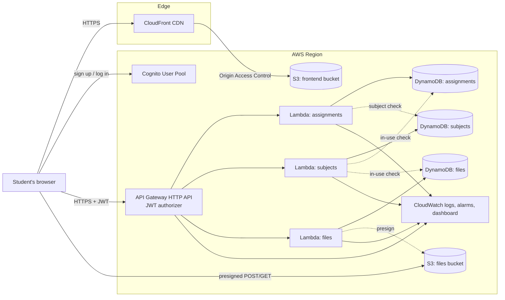

# Architecture

This document explains how Student Cloud Manager uses AWS: which services are involved, how data
flows, how security works, what it costs, how it scales and what happens when things fail.

The whole AWS environment is declared in [`infrastructure/template.yaml`](infrastructure/template.yaml).

## 1. AWS services



| Service | Role in this project | Why this service |
| --- | --- | --- |
| Cognito | User registration, email verification, login, JWTs | Managed identity: no password database to build or protect |
| API Gateway (HTTP API) | Public HTTPS API, JWT validation, CORS, throttling | HTTP APIs are simpler and cheaper than REST APIs and have a native JWT authorizer |
| Lambda | Validation, ownership checks, DynamoDB/S3 calls | Runs only when called and scales automatically |
| DynamoDB | Assignments, subjects, file metadata | Serverless NoSQL with predictable key lookups and on-demand billing |
| S3 (files) | The uploaded documents themselves | Object storage built for files; DynamoDB items are limited to 400 KB |
| S3 + CloudFront (web) | Hosts the React build over HTTPS | Static hosting plus a CDN, without a web server |
| CloudWatch | Logs, metrics, alarms, dashboard | Native to Lambda and API Gateway |
| IAM | One role per Lambda | Least privilege |
| Budgets + SNS (optional) | Cost and error emails | Cost safety |

**Why three Lambdas and not 15?** Each resource (assignments, subjects, files) gets one function
with a small router keyed on API Gateway's `routeKey`. Splitting every endpoint into its own function
would add deployment surface without adding learning value, and CLAUDE.md allows this
consolidation. Each function still gets its own IAM role.

## 2. Data model (DynamoDB)

The access patterns came first: *"get all X for this user"*, *"get / update / delete one X for this
user"*. Every table therefore uses the **owner as the partition key** and the item ID as the sort key:

| Table | Partition key | Sort key | Other attributes |
| --- | --- | --- | --- |
| `student-cloud-manager-assignments-dev` | `userId` | `assignmentId` | title, description, subject, dueDate, priority, completed, createdAt, updatedAt |
| `student-cloud-manager-subjects-dev` | `userId` | `subjectId` | name, createdAt |
| `student-cloud-manager-files-dev` | `userId` | `fileId` | fileName, subject, s3Key, contentType, fileSize, status, createdAt, uploadedAt, expiresAt (TTL) |

- "All assignments for a user" is a single `Query` on `userId`. No scans and no indexes are needed.
- One item can only be fetched with **both** keys, so ownership is built into the key itself.
- The files table has **TTL** on `expiresAt`. Upload requests that are never confirmed disappear on
  their own.
- On-demand capacity means there are no capacity units to provision.

## 3. Authentication flow

```text
Register:  Browser ──SignUp(email, password)──────────> Cognito ──email with 6-digit code──> Student
Verify:    Browser ──ConfirmSignUp(email, code)───────> Cognito
Login:     Browser ──InitiateAuth(USER_PASSWORD_AUTH)─> Cognito ──> ID, access, refresh tokens
API call:  Browser ──Authorization: Bearer <access>───> API Gateway (verifies signature, issuer,
                                                         client_id, expiry) ──> Lambda gets claims.sub
Refresh:   access token near expiry ──InitiateAuth(REFRESH_TOKEN_AUTH)──> new access token
Logout:    tokens cleared locally + RevokeToken(refresh token) at Cognito
```

- The frontend calls the public Cognito API directly with `fetch`
  ([`services/cognito.js`](frontend/src/services/cognito.js)) and needs no AWS SDK. The app client has
  **no secret**, because a browser cannot keep one.
- The password policy (8+ characters, upper case, lower case, number) is enforced by Cognito and
  mirrored in the UI as a live checklist.
- Access tokens last 60 minutes and refresh tokens 30 days. If refreshing fails, the user is sent to
  the login page with "Your session has expired".
- The route guards in React only improve UX. **The security boundary is API Gateway + Lambda.**

## 4. Assignment flow (example: create)

```text
1. Browser   POST /assignments {title, subject, dueDate, priority, description}
2. API GW    validates JWT → invokes AssignmentsFunction with claims.sub
3. Lambda    validateNewAssignment()      → 400 VALIDATION_ERROR if invalid
             resolveSubject(userId, name) → 400 SUBJECT_NOT_FOUND if the user has no such subject
             PutItem {userId: <from token>, assignmentId: uuid, …}
4. Lambda    201 {"success": true, "data": {…}}   (userId stripped from the response)
5. Browser   adds the card, shows a toast, dashboard numbers update on the next visit
```

Update and delete use `ConditionExpression: attribute_exists(assignmentId)` on the key
`(userId, assignmentId)`. If the item does not exist **for this user**, the result is `404`,
whether the ID is wrong or belongs to someone else.

## 5. File upload flow

```text
Browser                         API Gateway + Files Lambda                     S3 (private)
   │ POST /files {fileName,          │                                              │
   │   fileSize, subject} ─────────> │ validate type/size/name/subject              │
   │                                 │ PutItem status=PENDING, expiresAt=now+1h     │
   │                                 │ createPresignedPost(key, Content-Type,       │
   │ <── {file, upload:{url,fields}} │   content-length-range 1..10MB, 5 min)       │
   │ POST multipart form (with progress) ──────────────────────────────────────────>│ S3 enforces policy
   │ POST /files/{id}/complete ────> │ HeadObject(key) → exists? size ≤ 10 MB?     │
   │                                 │ UpdateItem status=UPLOADED, REMOVE expiresAt │
   │ <── {file}                      │                                              │
```

- **Files never pass through Lambda.** Large uploads don't hit Lambda's payload limit and don't cost
  Lambda time.
- S3 key: `users/{userId}/files/{fileId}/{sanitisedFileName}`. The Lambda's IAM policy only covers
  `users/*`.
- The content type is chosen by the server from the extension, not trusted from the browser.
- A file only counts as uploaded after `/complete` confirms the object exists. A failed upload never
  appears in the list.

**Download:** `GET /files/{id}/download` checks ownership and returns a 5-minute presigned GET URL
with `Content-Disposition: attachment`, and the browser downloads from S3 directly.
**Delete:** the S3 object is deleted first, then the metadata.

## 6. Security model

```text
Student
  ↓  HTTPS everywhere (CloudFront, API Gateway, Cognito, S3 deny non-TLS)
Cognito authentication             → only verified users get tokens
  ↓
API Gateway JWT authorizer         → invalid / expired / foreign tokens never reach Lambda
  ↓
Lambda validation                  → strict input rules, unknown fields ignored
  ↓
Ownership by key design            → userId from token is part of every DynamoDB key and S3 key
  ↓
IAM least privilege                → each Lambda can touch only its tables / the users/* prefix
  ↓
DynamoDB / S3 (encrypted at rest, buckets private, public access blocked)
```

More detail in [SECURITY.md](SECURITY.md).

## 7. Cost considerations

| Resource | Billing model | Cost control in this design |
| --- | --- | --- |
| Lambda | Per request + GB-seconds | 256 MB, arm64, 10 s timeout, no provisioned concurrency |
| API Gateway HTTP API | Per request | Throttling: 10 req/s, burst 20 |
| DynamoDB | On-demand per request + storage | No indexes, no point-in-time recovery, small items |
| S3 | Storage + requests | 10 MB file limit, abandoned multipart uploads removed after 1 day |
| CloudFront | Data transfer + requests | Price Class 100, aggressive caching of hashed assets |
| Cognito | Monthly active users | Lite tier |
| CloudWatch | Log ingestion/storage, alarms, dashboards | 14-day retention, 4 alarms, 1 dashboard |
| Budgets | First budgets free (verify) | Optional email at 80 % actual / 100 % forecast |

Nothing in this architecture costs money while idle except tiny storage charges. Check current
pricing and your account's free-tier status on the AWS pricing pages before deploying. Free-tier
terms differ between account types and change over time.

## 8. Scalability: what if 10 users become 10,000?

```text
More users → more API requests → API Gateway scales automatically
           → Lambda starts more concurrent instances automatically (up to the account concurrency limit)
           → DynamoDB on-demand absorbs the extra reads/writes; data is spread by userId
           → S3 and CloudFront handle file and website traffic without configuration
```

Things to adjust at large scale (not needed for the project): raise the API throttling limits,
request a higher Lambda concurrency quota, use SES instead of Cognito's default email sender, and
paginate list endpoints. Verify current service quotas in the AWS documentation before quoting
numbers in a presentation.

## 9. Availability

Every service used here is managed and Regional, running across multiple Availability Zones without
any configuration from us. We do not patch servers, replace disks or fail over databases. This is
the main operational lesson of the project. Multi-region deployment is intentionally out of scope.

## 10. Failure scenarios

| What fails | What the user sees | Why |
| --- | --- | --- |
| A Lambda throws | Friendly "Something went wrong. Please try again." with **Retry** | `createHttpHandler` turns unknown errors into `500 INTERNAL_ERROR`; details are logged to CloudWatch and the error alarm fires |
| DynamoDB unavailable / throttled | Same retryable error state | SDK retries automatically, then the request fails cleanly |
| S3 upload fails or the browser closes mid-upload | Upload error message; the file never appears in the list | Metadata stays `PENDING` and expires through TTL |
| User loses internet | "Could not reach the server. Check your internet connection…" | `fetch` network errors are mapped to `NETWORK_ERROR` |
| Access token expires | Transparent refresh; if that fails, back to login with "Your session has expired" | `api.js` refreshes and retries once |
| Invalid / missing token | `401` from API Gateway; never reaches Lambda | JWT authorizer |
| Another user's ID in the URL | `404 …_NOT_FOUND` | Key includes the caller's `userId` |
| Deleting a subject that is in use | `409 SUBJECT_IN_USE` with counts | Prevents dangling references |

## 11. Demo mode (offline)

When the frontend has no AWS configuration, `services/demo/demoBackend.js` imports the **same**
route handlers (`backend/src/apps/*.js`) and calls them with HTTP-API-shaped events.
`localStorage` stands in for DynamoDB and IndexedDB for S3. The demo therefore exercises the real
validation, ownership and error logic. It is used for Phase 1 development, for the automated
end-to-end tests, and as a fallback if the network fails during the live demo.

This is why the backend is split into:

- `src/apps/`, `src/shared/`, `src/local/`: pure JavaScript, no AWS SDK, runs in Node and browsers.
- `src/aws/`, `src/lambdas/`: AWS SDK adapters and Lambda entry points.

## 12. Key decisions

| Decision | Alternatives considered | Reason |
| --- | --- | --- |
| React + Vite | Plain HTML/JS, Next.js | Component reuse with minimal tooling; Next.js adds a server we don't need |
| HTTP API (v2) | REST API (v1) | Native JWT authorizer, simpler, lower cost |
| Cognito via `fetch` | AWS Amplify | No large dependency; each auth step stays easy to explain |
| 3 tables, `userId` partition key | Single-table design | Easier to explain in a viva; access patterns are simple |
| Presigned POST | Presigned PUT, upload through Lambda | S3 enforces size and content type; no Lambda payload limit |
| Upload confirmation endpoint | S3 event notification | Simpler and synchronous; S3 events are a future improvement |
| SAM | Console click-ops, CDK, Terraform | Reproducible, reviewable, one command to create or delete everything |
