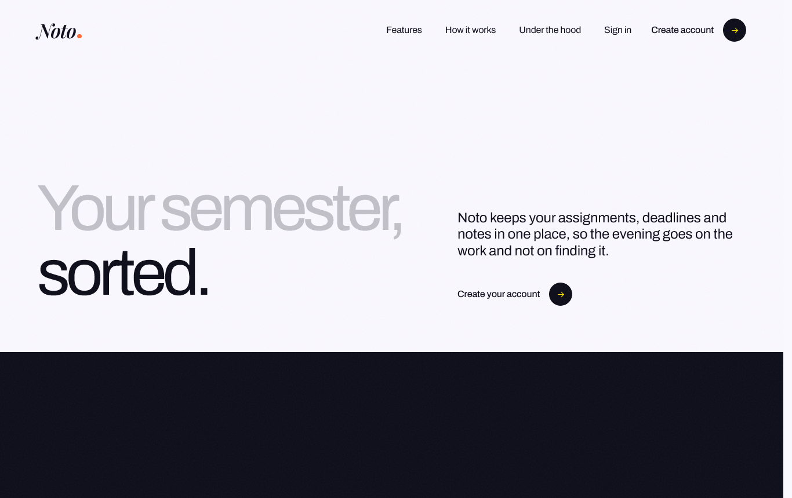
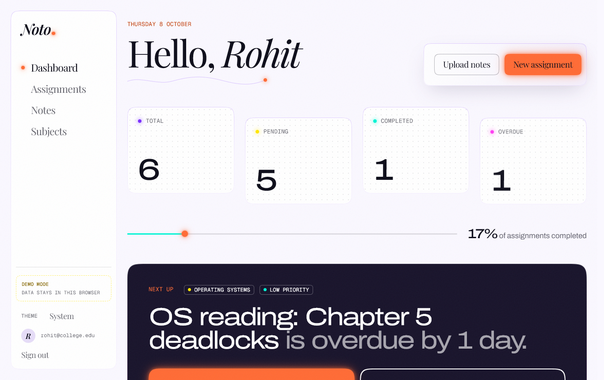
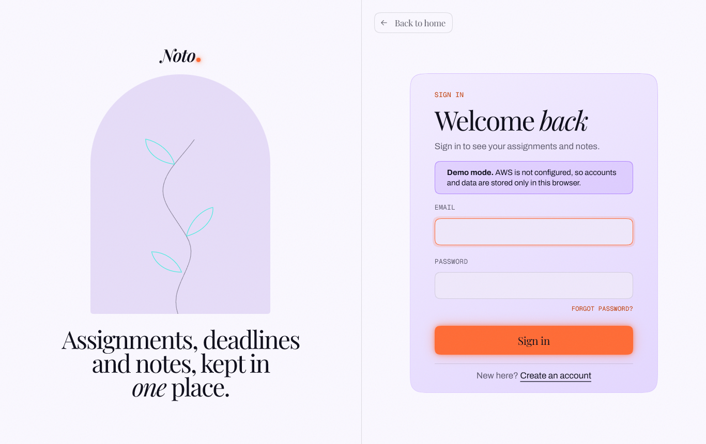
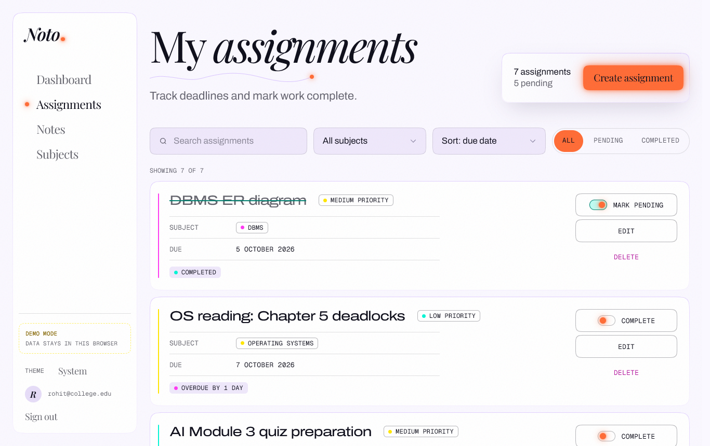
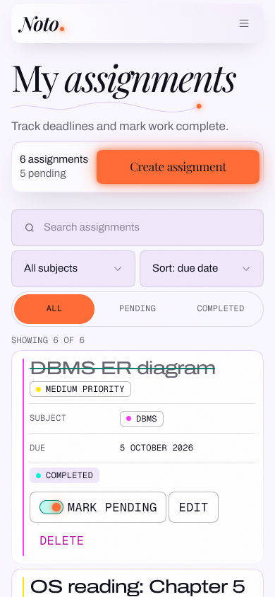
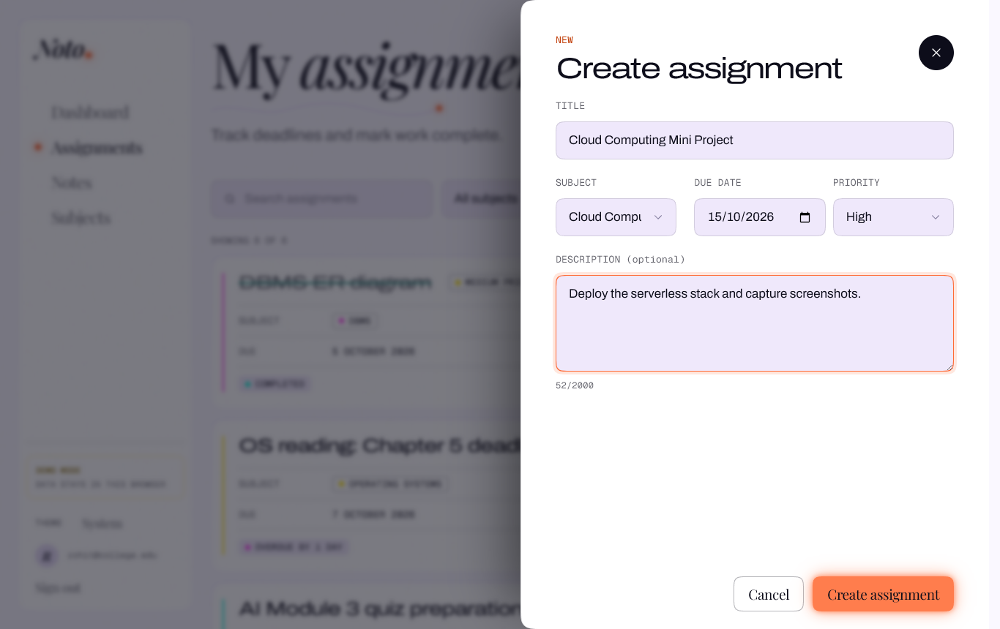
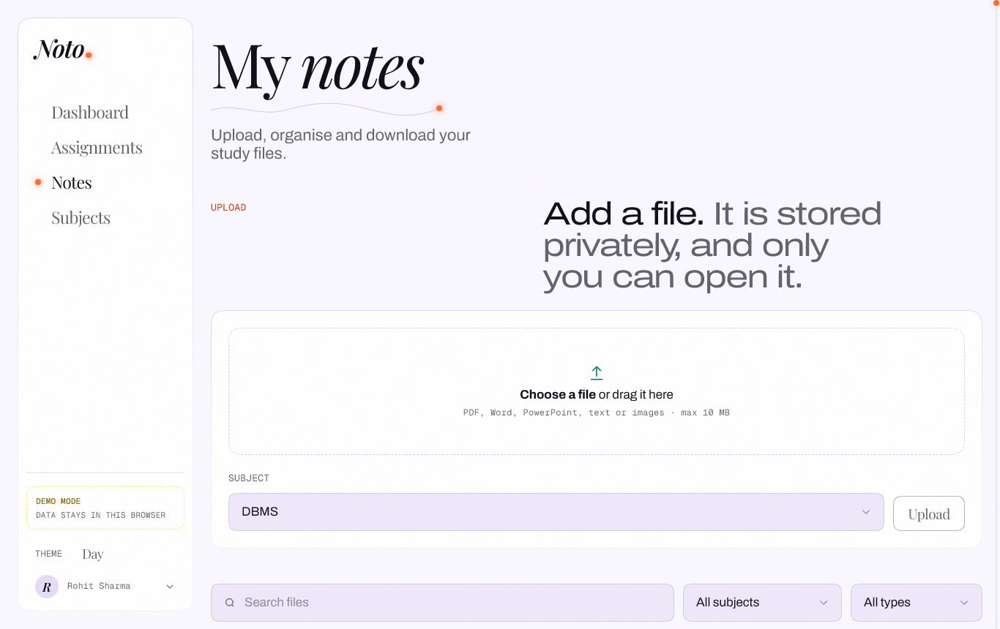
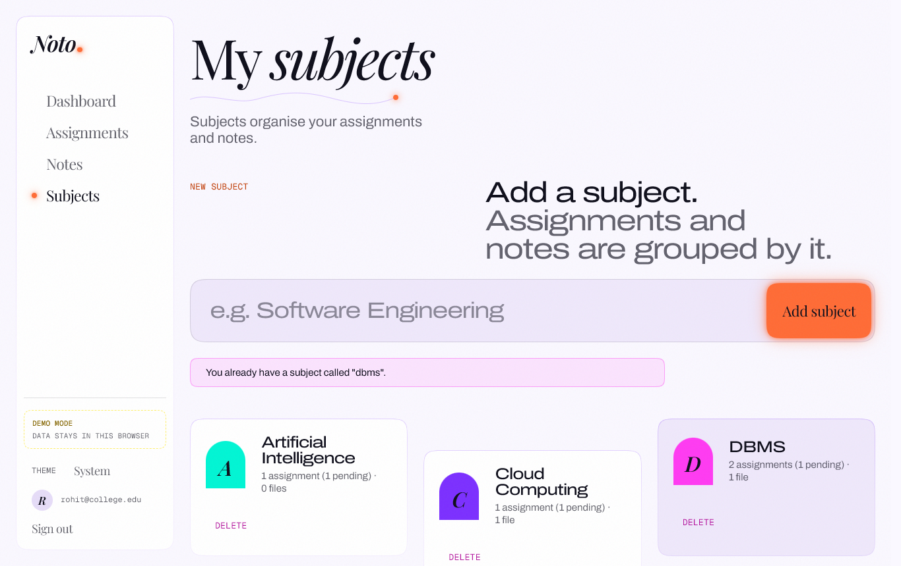
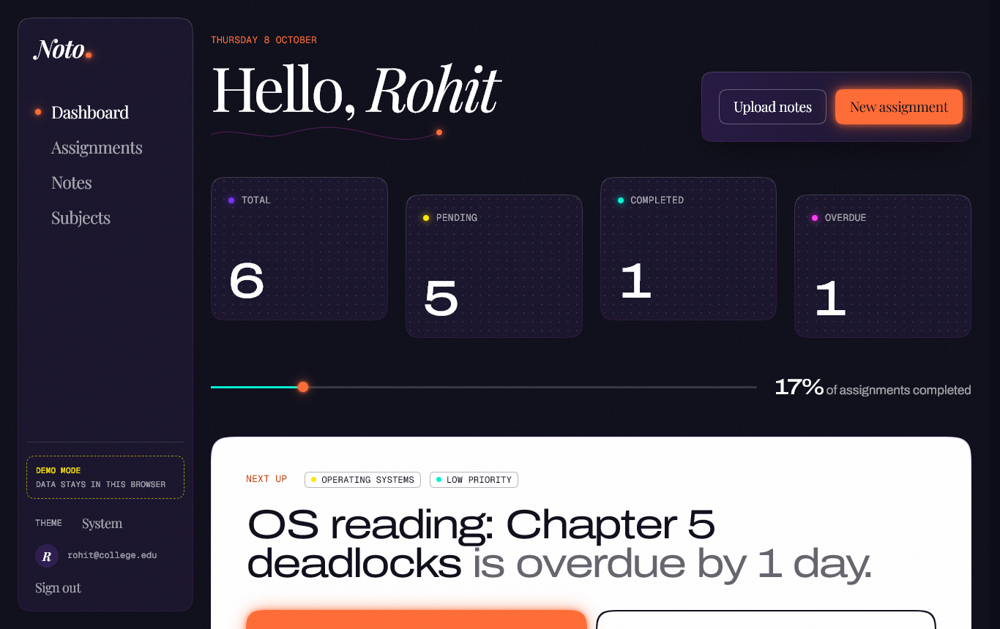

# Noto

**Noto** (project name: Student Cloud Manager) is a cloud-based student assignment & notes management system built on **AWS serverless services**.
Students register, log in, track assignments and deadlines, organise subjects, and upload,
download and delete their study files. All of this runs without managing a single server.



> **Status:** Deployed to AWS and online at **https://main.dg6fh880g1p8b.amplifyapp.com**. The backend
> and the hosted website are verified with live tests. See [Deployment](#deployment).

---

## Contents

- [Features](#features)
- [Architecture](#architecture)
- [AWS services](#aws-services)
- [Project structure](#project-structure)
- [Prerequisites](#prerequisites)
- [Installation & local development](#installation--local-development)
- [Environment variables](#environment-variables)
- [AWS setup](#aws-setup)
- [Deployment](#deployment)
- [Testing](#testing)
- [Security](#security)
- [Cost considerations](#cost-considerations)
- [Screenshots](#screenshots)
- [Known limitations](#known-limitations)
- [Future improvements](#future-improvements)

## Features

| Area | What a student can do |
| --- | --- |
| Authentication | Register, verify email, log in, log out, stay signed in (token refresh) |
| Assignments | Create, view, edit, delete, mark complete/pending, due date, priority, subject |
| Notes / files | Upload (drag & drop, progress bar), list, download, delete, organise by subject |
| Subjects | Create, list (with usage counts), delete (blocked while still in use) |
| Dashboard | Total / pending / completed / overdue counts, completion bar, upcoming deadlines, recent files |
| Extras | Search, filter by subject / status / file type, sort, light / dark theme, responsive mobile layout |
| Landing page | Public front page at `/` for signed-out visitors: what Noto does, how it works, the AWS services behind it, sign-up and sign-in |

Rules enforced by the backend: titles of 1–150 characters, descriptions up to 2000 characters, valid
`YYYY-MM-DD` due dates, subjects that exist, file types `.pdf .doc .docx .ppt .pptx .txt .png .jpg .jpeg`,
and a maximum file size of 10 MB.

## Architecture

```text
 Browser ──HTTPS──> CloudFront ──OAC──> S3 (frontend bucket, private)
    │               (or AWS Amplify Hosting while CloudFront is unavailable)
    │
    ├──HTTPS──> Cognito User Pool        (sign-up, login, JWT tokens)
    │
    ├──HTTPS + JWT──> API Gateway HTTP API ──> Lambda: assignments ──> DynamoDB
    │                 (Cognito authorizer)     Lambda: subjects    ──> DynamoDB
    │                                          Lambda: files       ──> DynamoDB + S3 (presign)
    │
    └──presigned POST / GET──> S3 (files bucket, private)

 CloudWatch: Lambda logs, API access logs, alarms, dashboard   IAM: least-privilege role per Lambda
```

Full details (data flows, security model, failure scenarios, scalability) are in
[ARCHITECTURE.md](ARCHITECTURE.md). There is a slide-ready diagram in
[docs/architecture/architecture.svg](docs/architecture/architecture.svg).

## AWS services

| Service | Used for |
| --- | --- |
| **Amazon Cognito** | User pool: registration, email verification, login, access/refresh tokens |
| **Amazon API Gateway** (HTTP API) | REST endpoints, JWT authorizer, CORS, throttling, access logs |
| **AWS Lambda** (Node.js 22, arm64) | Business logic: validation, ownership checks, presigned URLs |
| **Amazon DynamoDB** (on-demand) | Assignments, subjects and file metadata (partition key `userId`) |
| **Amazon S3** | Private bucket for uploaded files + private bucket for the website |
| **Amazon CloudFront** | HTTPS CDN for the website, security headers, SPA routing |
| **AWS Amplify Hosting** | Hosts the website over HTTPS while the account is not yet verified for CloudFront |
| **Amazon CloudWatch** | Logs (14-day retention), error alarms, monitoring dashboard |
| **AWS IAM** | One least-privilege role per Lambda; no administrator access anywhere |
| **AWS Budgets** / **SNS** (optional) | Monthly cost alert and alarm emails |

Everything is defined in [`infrastructure/template.yaml`](infrastructure/template.yaml) (AWS SAM).

## Project structure

```text
.
├── frontend/                 React 19 + Vite single-page app
│   ├── src/components/       UI building blocks (cards, forms, modal, toast, sidebar…)
│   ├── src/pages/            Login, Register, ConfirmAccount, Dashboard, Assignments, Notes, Subjects
│   ├── src/services/         api.js, auth.js, cognito.js, files.js, demo/ (offline demo backend)
│   ├── src/hooks/            useAuth, useResource, useTheme
│   └── src/utils/            dates, formatting, filters, password rules
├── backend/                  Lambda code (Node.js, ES modules)
│   ├── src/apps/             Route logic per resource (pure JS, no AWS imports, unit-tested)
│   ├── src/shared/           Validation, responses, errors, HTTP wrapper, logger, constants
│   ├── src/aws/              DynamoDB repository + S3 presigning (AWS SDK v3)
│   ├── src/lambdas/          Lambda entry points (wire apps to AWS)
│   └── test/                 node:test unit tests
├── infrastructure/
│   ├── template.yaml         AWS SAM template (entire AWS architecture)
│   ├── samconfig.toml        SAM CLI defaults
│   └── scripts/              deploy.ps1 / deploy.sh, destroy.ps1 / destroy.sh
├── e2e/                      Headless-Chrome end-to-end test (also generates the screenshots)
├── docs/                     screenshots, architecture diagram, presentation + viva notes
└── *.md                      README, ARCHITECTURE, API, SECURITY, TESTING, CHANGELOG, TODO, PROJECT_CONTEXT
```

## Prerequisites

| Tool | Needed for | Version used |
| --- | --- | --- |
| Node.js + npm | Frontend & backend | Node 24.19 / npm 11.17 (Node ≥ 22 required) |
| Git | Version control | 2.51 |
| AWS account | Deployment only | — |
| AWS CLI v2 | Deployment only | latest |
| AWS SAM CLI | Deployment only | latest |

## Installation & local development

```bash
git clone <repository>
cd <repository>

# Backend (needed for tests; the frontend's demo mode also reuses its route logic)
cd backend
npm install
npm test

# Frontend
cd ../frontend
npm install
npm run dev          # http://localhost:5173
```

### Demo mode (no AWS needed)

If the `VITE_*` variables below are **not** set, the app starts in **demo mode**:

- Accounts are kept in the browser. Any 6-digit verification code works.
- The **real Lambda route handlers** from `backend/src/apps` run inside the browser. DynamoDB is
  replaced by `localStorage` and S3 by IndexedDB, so validation, ownership checks and error messages
  behave exactly as they do in AWS.
- A new demo account is seeded with sample subjects, assignments and notes for presentations.
- A yellow **Demo mode** badge is always visible, so nobody mistakes it for the cloud deployment.

With the variables set (for example after `deploy.ps1`), the same build talks to Cognito and API Gateway.

## Environment variables

`frontend/.env.example` (copy to `frontend/.env.local`, which git ignores):

| Variable | Example | Source (stack output) |
| --- | --- | --- |
| `VITE_AWS_REGION` | `ap-south-1` | `Region` |
| `VITE_COGNITO_USER_POOL_ID` | `ap-south-1_AbCdEf123` | `UserPoolId` |
| `VITE_COGNITO_CLIENT_ID` | `1a2b3c…` | `UserPoolClientId` |
| `VITE_API_URL` | `https://abc123.execute-api.ap-south-1.amazonaws.com` | `ApiUrl` |

None of these are secrets: they are public identifiers that every browser receives. The deploy
script writes the file for you. Lambda configuration (table and bucket names) is injected by the
SAM template as Lambda environment variables. No AWS keys are used anywhere in the code.

## AWS setup

1. Create an AWS account and **enable MFA on the root user**. Then create an IAM user or SSO
   profile for yourself and stop using the root account.
2. Install the [AWS CLI v2](https://docs.aws.amazon.com/cli/latest/userguide/getting-started-install.html)
   and run `aws configure` (choose a region near you, e.g. `ap-south-1`).
3. Install the [AWS SAM CLI](https://docs.aws.amazon.com/serverless-application-model/latest/developerguide/install-sam-cli.html).
4. Check current pricing and free-tier eligibility for the services above. AWS pricing changes, so
   do not rely on numbers in old documents.

## Deployment

One command (Windows PowerShell):

```powershell
.\infrastructure\scripts\deploy.ps1 -AlertEmail you@example.com
```

or on macOS / Linux / Git Bash:

```bash
infrastructure/scripts/deploy.sh --alert-email you@example.com
```

The script performs every deployment step:

1. **Build and deploy the backend stack**: `sam build && sam deploy`. This creates Cognito, API
   Gateway, the three Lambdas, the three DynamoDB tables, both S3 buckets, CloudFront, the
   CloudWatch log groups, alarms and dashboard, plus (with an email) an SNS topic and a monthly
   budget. SAM shows a change set; review it and confirm.
2. **Configure the frontend**: it reads the stack outputs and writes `frontend/.env.local`.
3. **Build the frontend**: `npm run build` (`npm ci` first if `node_modules` is missing).
4. **Upload to S3**: hashed assets are cached for a year, while `index.html` is served `no-cache`.
5. **Invalidate CloudFront** and print the website URL.

With `-NoCloudFront`, steps 4 and 5 are replaced by a zip upload to AWS Amplify Hosting.

`-AlertEmail` is optional but recommended. AWS sends confirmation emails for the SNS
subscription and the budget, and you must click the SNS confirmation link.

**New AWS accounts:** CloudFront refuses to create resources until AWS verifies the account
("Your account must be verified before you can add new CloudFront resources"). Until then deploy
with `-NoCloudFront`: everything except CloudFront is created, and the website is hosted on
AWS Amplify Hosting instead (HTTPS, `https://main.<app-id>.amplifyapp.com`). Open a free AWS
Support case (Account and billing) quoting the error, then deploy again without the switch.

Re-deploy only the frontend: `deploy.ps1 -FrontendOnly`.
Remove everything after the demo: `.\infrastructure\scripts\destroy.ps1` (asks for confirmation).

To run the local dev server against the deployed backend, run `deploy.ps1` once (it writes
`.env.local`) and then `npm run dev` in `frontend/`. `http://localhost:5173` is an allowed CORS origin.

## Testing

| Suite | Command | Result |
| --- | --- | --- |
| Backend unit tests (validation, CRUD, ownership, errors, S3 presigning, DynamoDB expressions) | `cd backend && npm test` | 36 / 36 passing |
| Frontend unit tests (dates, filters, dashboard maths and next-up pick, subject colours, demo backend) | `cd frontend && npm test` | 19 / 19 passing |
| End-to-end browser run (headless Chrome, demo mode) | `cd e2e && npm test` (with `npm run dev` running) | 32 / 32 checks passing |
| Live API against the deployed stack (Cognito, API, DynamoDB, S3, isolation) | `node e2e/live-api.mjs` | 36 / 36 passing (2026-10-08) |
| Live website in headless Chrome (sign-in, CRUD, S3 upload/download, sign-out) | `node e2e/live-site.mjs` | 17 / 17 passing (2026-10-08) |
| Landing page motion (nav, scroll scrubs, card stack, timeline, dialog, reduced motion) | `node e2e/landing-motion.mjs` | 19 / 19 passing (2026-10-08) |
| Infrastructure lint | `cfn-lint infrastructure/template.yaml` | 0 findings |

Still to do by hand: sign-up with a real email inbox. [TESTING.md](TESTING.md) contains the
manual checklist.

## Security

- Passwords are handled only by Cognito; the app never stores them.
- Every API route requires a valid Cognito JWT. API Gateway rejects anything else before Lambda runs.
- The backend takes `userId` **only** from the verified token, never from the request. Every
  DynamoDB key starts with `userId`, so one user's data cannot be addressed by another user (404).
- Both S3 buckets are private. Files are uploaded and downloaded with presigned URLs that expire
  after 5 minutes and are locked to one key (upload also to an exact content type and a 10 MB limit).
- Each Lambda has its own least-privilege IAM role.
- Errors returned to the client are sanitised. Technical details go to CloudWatch only, and tokens
  and passwords are never logged.

Full model and checklist: [SECURITY.md](SECURITY.md).

## Cost considerations

The architecture is pay-per-use, with nothing running while idle:

- Lambda, API Gateway, DynamoDB on-demand and S3 are billed per request and storage.
- Cognito uses the **Lite** tier. CloudFront uses the cheapest price class. Amplify Hosting
  (the fallback host) charges only for storage and transfer, cents for this site.
- Log retention is 14 days. API throttling (10 req/s, burst 20) caps runaway costs.
- An optional **AWS Budget** emails you at 80 % of the monthly limit (default USD 5).
- `destroy.ps1` removes everything after the demo.

Most of these services offer free usage for small student projects, but free-tier rules differ
between accounts and change over time. **Check the AWS pricing pages before deploying.**

## Screenshots

These are captured from the app in demo mode by the automated end-to-end run:

| | |
| --- | --- |
|  |  |
|  |  |
|  |  |
|  |  |

AWS Console screenshots (Cognito, DynamoDB, S3, Lambda, API Gateway, CloudWatch, IAM) must be
captured after deployment. The list is in [docs/presentation/DEMO_SCRIPT.md](docs/presentation/DEMO_SCRIPT.md).

## Known limitations

- Not yet deployed or verified against real AWS (see Status above).
- Cognito's default email sender has a low daily limit, which is fine for a class demo. Use Amazon
  SES for real traffic.
- Tokens are kept in `localStorage` for simplicity. This is a common SPA trade-off; a stricter design
  would use an HTTP-only cookie flow.
- Subjects cannot be renamed (create a new one, move items, delete the old one).
- If a browser uploads a file to S3 but never calls `/complete`, the metadata record expires through
  DynamoDB TTL, but the orphaned S3 object stays until cleaned up manually.
- Lists load all of a user's items at once, which is fine for hundreds of items per student.

## Future improvements

Email reminders before deadlines, a calendar view, professor accounts and assignment submission,
S3 event-driven upload confirmation, search indexing, and a CI pipeline that runs the tests and
`cfn-lint` on every push.
